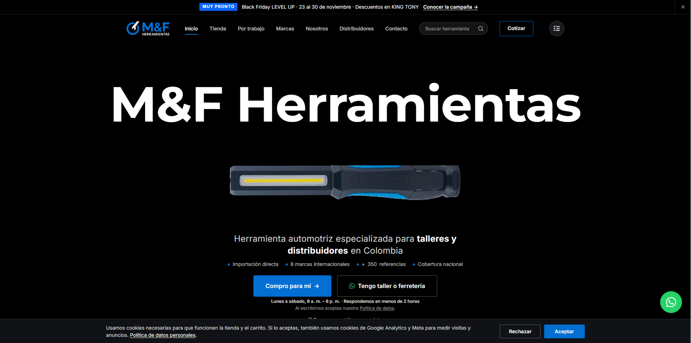

# M&F Herramientas | Website Showcase

  

  <strong>Corporate Website · Digital Product Catalog · Automotive Tools</strong>

  

---

## About the Project

**M&F Herramientas** is a Colombian company specializing in the import and distribution of automotive and professional tools.

This project showcases the company's digital presence, designed to present its product portfolio, strengthen its brand identity, and connect customers with its commercial channels.

## Key Features

- **Digital product catalog:** Explore professional tools and product categories.
- **Brand presentation:** Discover specialized tool brands.
- **Product discovery:** Navigate the catalog to find relevant solutions.
- **Customer inquiries:** Access contact and quotation channels.
- **Business-oriented design:** A digital experience tailored to professional customers and distributors.

## Project Objectives

- Strengthen the company's online presence.
- Improve product discovery and catalog accessibility.
- Support customer inquiries and quotation requests.
- Connect the company's commercial offering with its digital channels.

## Live Website

Explore the published website:

**[https://herramientas.net.co/](https://herramientas.net.co/)**

## Repository Scope

This repository is a **public portfolio showcase**. It is separate from the production website repository and does not contain deployment configuration, private credentials, API secrets, or production source files.

---

  Portfolio project · M&F Herramientas S.A.S. · Colombia

